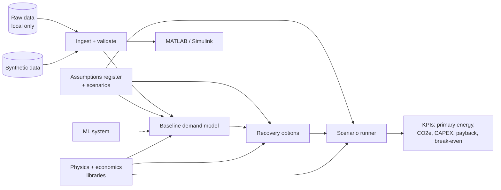

# ES327: Data-Centre Waste-Heat Reuse

Techno-economic model for reusing ~700 kW of waste heat from an HPC data centre to replace
gas-fired heating in its host building. BEng Systems Engineering individual project,
University of Warwick, industry-sponsored.

## Architecture



| Layer | Location | Role |
|---|---|---|
| Data | `src/twhr/data/` | Load the data pack, run quality checks (gaps, duplicates, out-of-range values), generate synthetic stand-in data |
| Assumptions | `configs/` | Every parameter with value, unit, source and status. Scenario files override the base values. Strict mode blocks unsourced placeholders |
| Libraries | `src/twhr/physics/`, `economics/` | Building-block equations (heat loss, COP, NPV, payback), each tested against a hand calculation |
| Subsystems | `baseline/`, `recovery/`, `ml/` | Calibrated host-building heat demand, waste-heat recovery options, ML component |
| Interfaces | `src/twhr/interfaces.py` | Fixed inputs and outputs between subsystems, so each can be built and verified separately |
| Orchestration | `src/twhr/scenarios/` | Runs each option across conservative, central and optimistic scenarios (Monte Carlo as an extension) |
| MATLAB | `matlab/` | Simulink/MATLAB models reading the same processed data |

**Design principles**
- **One source of truth.** Data ingest and assumptions live in one place; Python and MATLAB both read from it.
- **Traceability.** Requirements map to verification methods (`docs/requirements.md`), and design choices are recorded in `docs/decisions/`.
- **Verification by default.** Unit tests and CI run on synthetic data only.
- **Data stays private.** Sponsor data stays in `data/raw/` and is gitignored.

## Repository layout

```
configs/      assumptions register and scenario overrides
data/         raw / interim (gitignored), synthetic
docs/         requirements, decision records, data register, AI-use log
matlab/       MATLAB functions and Simulink models
notebooks/    exploration only
scripts/      entry points (e.g. ingest.py)
src/twhr/     Python package
tests/        pytest suite
```

## Quick start (Windows)

```powershell
py -3.13 -m venv .venv
.\.venv\Scripts\Activate.ps1
pip install -e ".[dev]"
pytest
python scripts\ingest.py --synthetic
```

For MATLAB, run `matlab/startup.m` to add the project paths.
